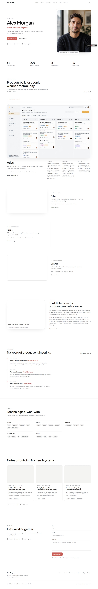
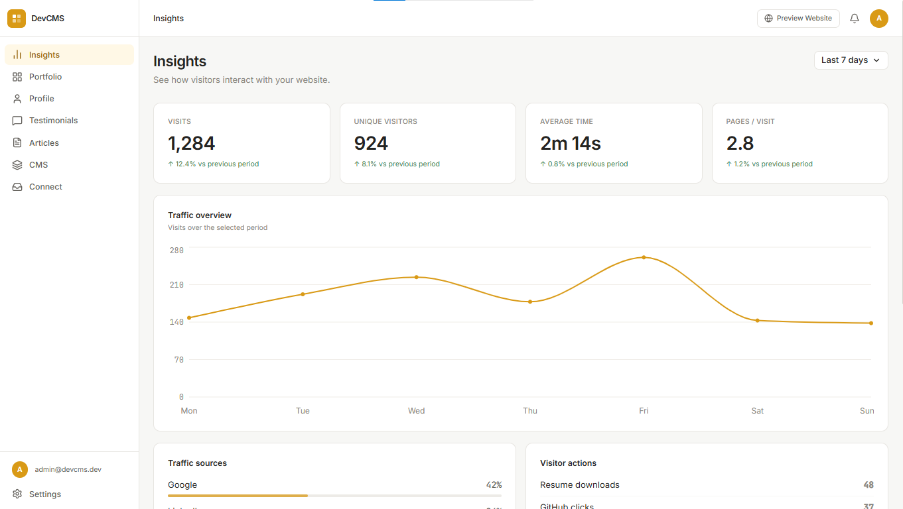
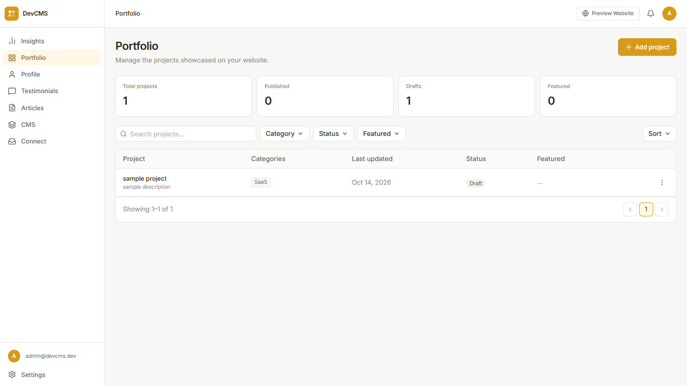
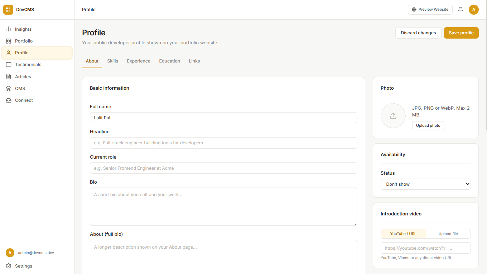

# DevCMS

**A portfolio website and content management system for developers.**

DevCMS is a personal project focused on helping developers manage their professional online presence through a dedicated portfolio website and administration panel.

It brings professional profile information, projects, testimonials, articles, and configurable website content into one place, with the goal of making portfolio maintenance simpler and more consistent.

## Live Portfolio

**Website:** [lalitpal.com](https://lalitpal.com)

The application source code is maintained in a separate private repository. This public repository showcases the product, its architecture, design decisions, and development approach.

## Screenshots

### Public Portfolio

### Administration Panel — Insights

### Administration Panel — Portfolio Management

### Administration Panel — Profile Management

## The Problem

A developer's professional profile changes over time as they learn new skills, gain experience, complete projects, and share knowledge.

Maintaining an up-to-date portfolio should not require manually managing disconnected pieces of content. DevCMS explores a centralized approach to managing professional information and presenting it through a dedicated website.

## Product Modules

DevCMS is organized around the following modules:

- **Insights:** Portfolio traffic and engagement metrics.
- **Portfolio:** Project management, descriptions, and categories.
- **Profile:** About information, skills, experience, education, and professional links.
- **Testimonials:** Management of testimonials presented on the portfolio.
- **Articles:** Creation and management of professional and technical content.
- **CMS:** Configurable website sections and content, such as homepage banners.

The modules have distinct responsibilities to keep content organized and minimize duplication.

## Technology Stack

DevCMS follows a MERN-oriented architecture with Vite supporting frontend development.

- **Frontend:** React and Vite
- **Backend:** Node.js and Express.js
- **Database:** MongoDB
- **UI/UX design:** Figma

## Design Principles

- **Clear content ownership:** Each module has a defined responsibility.
- **Consistent experience:** Shared design patterns and reusable components support a coherent administration interface.
- **Structured information:** Professional data is organized for consistent presentation and future reuse.
- **Maintainability:** The product is designed to evolve without introducing unnecessary complexity.
- **Incremental development:** Features are developed around practical needs and clear product priorities.

## Architecture and Engineering

The project documentation covers the system's structure, the responsibilities of its main components, and the reasoning behind key product and engineering decisions.

- [Architecture Overview](docs/architecture.md) — system structure, application layers, and request flow.
- [Engineering Decisions](docs/engineering-decisions.md) — design choices, rationale, and trade-offs.

## Future Direction

Potential extensions include additional portfolio templates, generating resumes from structured profile data, and expanding portfolio insights.

These possibilities provide direction for future development while keeping the initial product focused.

## Project Status

DevCMS is an evolving personal project with a deployed public portfolio and a dedicated administration experience. Its development brings together product planning, UI/UX design, frontend development, backend integration, and deployment.

## Repository

[DevCMS-Showcase on GitHub](https://github.com/Lalit-Pal/DevCMS-Showcase)

This repository contains public-facing documentation and screenshots rather than the private application source code.