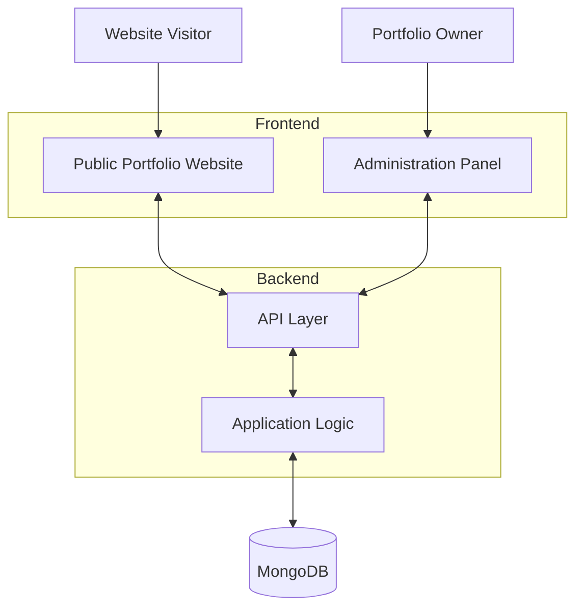

# DevCMS Architecture

## Overview

DevCMS combines a developer's public portfolio website with an administration panel for managing professional information and website content.

The application is organized into three main layers:

- **Frontend applications:** The public portfolio website and the administration panel.
- **Backend:** Application APIs and business logic.
- **Database:** Persistent storage for application data.

This separation allows the public-facing experience and the content-management interface to serve different purposes while working with shared application data.

## System Architecture

## Frontend Applications

### Public Portfolio Website

The public website presents a developer's professional identity and work. It brings together profile information, skills, experience, projects, testimonials, articles, and configurable website content.

Its primary goal is to make professional information accessible and present it through a cohesive portfolio experience.

### Administration Panel

The administration panel provides a centralized interface for managing the content that powers the portfolio website.

| Module | Responsibility |
|---|---|
| Insights | Portfolio traffic and engagement |
| Portfolio | Project information and categories |
| Profile | About, skills, experience, education, and links |
| Testimonials | Professional testimonials |
| Articles | Article creation and management |
| CMS | Configurable website sections and content |

Each module has a defined responsibility to minimize duplicated content and make the system easier to maintain.

## Backend and Data Layer

The backend uses Node.js and Express.js to provide the application API and handle server-side application logic. MongoDB serves as the data store.

The backend connects frontend operations to persistent data and provides a place for request validation, business rules, and access control.

The data model follows the product's major domains, including profile information, portfolio projects, testimonials, articles, and configurable website content.

## Request Flow

### Content Management

1. The portfolio owner makes a change through the administration panel.
2. The frontend sends the relevant request to the backend API.
3. The backend processes the request and interacts with the database.
4. The response is returned to the administration panel, which updates the interface accordingly.

### Public Content Delivery

1. A visitor opens the portfolio website.
2. The frontend obtains the content required for the page.
3. The website presents the available portfolio information to the visitor.

## Architectural Principles

**Separation of concerns**

The public website focuses on presentation, the administration panel on content management, the backend on application logic, and the database on persistence.

**Single ownership of content**

Each content domain has a clear home. For example, professional experience belongs to Profile, while configurable homepage sections belong to CMS.

**Reusable design patterns**

Shared components and design tokens support consistency across the administration interface.

**Incremental extensibility**

The product is designed to accommodate future capabilities, including additional portfolio templates and resume generation from structured profile data.

**Security and maintainability**

Application credentials remain private, and administrative operations require appropriate validation and access control.

## Deployment

DevCMS is available through the following web experiences:

- [Public portfolio](https://lalitpal.com)

The application source code is maintained in a private repository. This showcase documents the product and its engineering approach without exposing private implementation details.